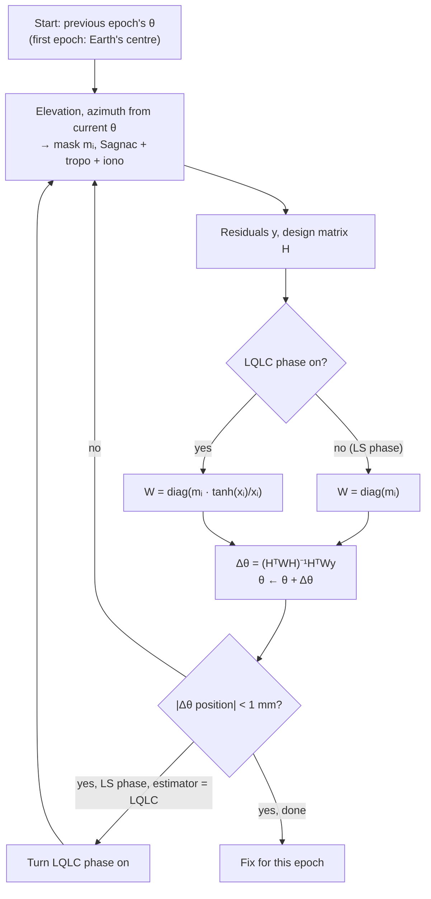

# LQLC for SPP: from the cost function to Δθ

How `spp_switches.py` computes a position each epoch, step by step. At the end, what we changed to get the best result.

---

## 1. Unknowns

$$
\theta = \begin{bmatrix} x & y & z & b_{GPS} & b_{GLO} & b_{GAL} & b_{BDS} \end{bmatrix}^T
$$

- $x, y, z$: receiver position (ECEF, m)
- $b_{sys}$: receiver clock offset × $c$, one per satellite system (m). A system with no satellite in the epoch is left out.

`spp_switches.py:146`, inside `solve_epoch`: one clock column per system present, after x, y, z.

```python
systems = [s for s in cfg["systems"] if (sysid == s).any()]
col = {s: 3 + k for k, s in enumerate(systems)}          # column of each system's clock in theta
theta = np.r_[theta0[:3], np.zeros(len(systems))]        # start: previous epoch's position, clocks 0
if len(theta0) == len(theta): theta = theta0.copy()      # same systems as before: reuse clocks too
```

## 2. Measurement model

For satellite $i$ (position $\mathbf{p}_i$, system $k(i)$):

$$
\rho_i = \underbrace{\lVert \mathbf{p}_i - \mathbf{r} \rVert}_{\text{geometric range } R_i} + b_{k(i)} + \underbrace{S_i + T_i + I_i}_{\text{corrections}} + \varepsilon_i
$$

| Term | Meaning | In code |
|---|---|---|
| $\rho_i$ | `cor_pseudo` (satellite clock already removed by the receiver) | input |
| $S_i = \frac{\omega_e}{c}(x_i\,y_r - y_i\,x_r)$ | Sagnac: Earth rotates during signal travel | `sagnac` |
| $T_i$ | troposphere delay, Saastamoinen | `tropo_saastamoinen` |
| $I_i$ | ionosphere delay, Klobuchar (default coefficients), scaled by $(f_{L1}/f_i)^2$ | `iono_klobuchar` |
| $\varepsilon_i$ | noise, multipath, NLOS (the part LQLC deals with) | |

`spp_switches.py:122`: all three corrections, recomputed from the current position at every iteration.

```python
def iter_terms(sat_xyz, sysid, tow, theta, cfg, have_pos):
    """Every iteration: position-dependent terms from the CURRENT theta."""
    n = len(sat_xyz)
    if not have_pos:                      # theta still at Earth's centre: nothing computable
        return np.zeros(n), np.ones(n, bool)
    rx = theta[:3]
    el, az = el_az(sat_xyz, rx)
    corr = (sagnac(sat_xyz, rx) + tropo_saastamoinen(el, rx)
            + iono_klobuchar(el, az, rx, tow) * (FREQ[1] / np.vectorize(FREQ.get)(sysid)) ** 2)
    keep = el >= np.radians(cfg["mask_deg"])      # mask m_i
    return corr, keep


def sagnac(sat_xyz, rx):
    """Earth rotation during signal travel, as a range term (m)."""
    return OMEGA_E / C * (sat_xyz[:, 0] * rx[1] - sat_xyz[:, 1] * rx[0])
```

## 3. Residual and linearisation

At the current estimate $\theta_n$, the **residual** (error) of satellite $i$ is

$$
e_i = y_i = \rho_i - \big(R_i(\theta_n) + b_{k(i)} + S_i + T_i + I_i\big)
$$

A small step $\Delta\theta$ changes the predicted range by $\mathbf{H}_i\,\Delta\theta$ (first-order Taylor), so

$$
e_i(\theta_n + \Delta\theta) \approx y_i - \mathbf{H}_i\,\Delta\theta
$$

with row $i$ of the **design matrix** $\mathbf{H}$:

$$
\mathbf{H}_i = \Big[\; -\frac{(\mathbf{p}_i - \mathbf{r})^T}{R_i} \;\;\Big|\;\; 0 \cdots \underset{k(i)}{1} \cdots 0 \;\Big]
$$

The first three entries are minus the unit vector from receiver to satellite. The clock entry is 1 in the column of the satellite's own system.

`spp_switches.py:154`: residual $\mathbf{y}$ and design matrix $\mathbf{H}$.

```python
corr, keep = iter_terms(sat_xyz, sysid, tow, theta, cfg, have_pos)
vec = sat_xyz - theta[:3]                                   # p_i - r
rng = np.linalg.norm(vec, axis=1)                           # R_i
clk = np.array([theta[col[s]] for s in sysid])              # b_k(i)
y = rho - (rng + clk + corr)                                # residual e_i = y_i
H = np.zeros((len(y), len(theta)))
H[:, :3] = -vec / rng[:, None]                              # minus unit vector
for i, s in enumerate(sysid): H[i, col[s]] = 1.0            # 1 in own system's clock column
```

## 4. Cost functions

Both estimators minimise a sum over the satellites above the mask ($m_i = 1$):

$$
J(\theta) = \sum_i m_i \; \rho(e_i)
$$

| | Cost $\rho(e)$ | For large $e$ |
|---|---|---|
| **LS** | $\tfrac12 e^2$ | grows like $e^2$, so one bad satellite dominates |
| **LQLC** | $4s^2 \ln\cosh\!\left(\dfrac{e}{2s}\right)$ | grows like $\lvert e\rvert$, so a bad satellite counts less |

For small $e$, $\ln\cosh(u) \approx u^2/2$, so LQLC ≈ $4s^2 \cdot \frac{e^2}{8s^2} = \tfrac12 e^2$: **it equals LS for small errors.**
The scale $s$ (m) sets where "small" ends.

(The code writes the cost as $\ln\cosh(e/2s)$ without $4s^2$. That only multiplies every weight by the same constant $1/4s^2$, which cancels in step 6.)

## 5. Influence function and weight

Set the derivative of $J$ to zero. Since $\partial e_i/\partial\theta = -\mathbf{H}_i$:

$$
\frac{\partial J}{\partial \theta} = -\sum_i m_i\, \psi(e_i)\, \mathbf{H}_i^T = 0,
\qquad \psi(e) = \frac{d\rho}{de}
$$

Write $\psi(e_i) = w_i\, e_i$, i.e. define the **weight** $w_i = \psi(e_i)/e_i$:

| | $\psi(e)$ | $w = \psi(e)/e$ |
|---|---|---|
| **LS** | $e$ | $1$ |
| **LQLC** | $2s \tanh\!\left(\dfrac{e}{2s}\right)$ | $\dfrac{\tanh(x)}{x}$, with $x = \dfrac{\lvert e\rvert}{2s}$ |

So the diagonal weight matrix is

$$
\boxed{\;W_{ii} = m_i \cdot \frac{\tanh(x_i)}{x_i}, \qquad x_i = \frac{\lvert e_i\rvert}{2s}\;}
\qquad (W_{ii} = m_i \text{ for LS})
$$

$\tanh(x)/x$ is 1 at $x = 0$ and falls like $1/x$: with $s = 5$, an error of 5 m gives 0.92, 10 m gives 0.76, 30 m gives 0.33 and 100 m gives 0.10. It never reaches 0, so a satellite is shrunk, never removed.

Notation: with $r = e/s$, $x = r/2$. Writing $W = \tanh(r)/r$ with $r = e/s'$ is the same thing with $s' = 2s$.

`spp_switches.py:135`: the LQLC weight. At $x = 0$, $\tanh(x)/x$ is 0/0, so it is set to its limit, 1.

```python
def lqlc_weight(y, s):
    x = np.abs(y) / (2 * s)
    return np.where(x < 1e-8, 1.0, np.tanh(x) / np.maximum(x, 1e-12))
```

`spp_switches.py:163`: building $W_{ii}$ (as a vector `w`, the diagonal of $W$).

```python
w = keep.astype(float)                       # m_i: 1 above the mask, 0 below  (LS)
if robust_on:
    w = w * lqlc_weight(y, cfg["s"])         # m_i * tanh(x_i)/x_i           (LQLC)
```

## 6. Normal equations: Δθ

The condition from step 5, in matrix form, is $\mathbf{H}^T W \mathbf{e} = 0$. Put in $\mathbf{e} \approx \mathbf{y} - \mathbf{H}\Delta\theta$ from step 3:

$$
\mathbf{H}^T W (\mathbf{y} - \mathbf{H}\,\Delta\theta) = 0
\;\;\Longrightarrow\;\;
\mathbf{H}^T W \mathbf{H}\,\Delta\theta = \mathbf{H}^T W \mathbf{y}
$$

$$
\boxed{\;\Delta\theta = (\mathbf{H}^T W \mathbf{H})^{-1}\, \mathbf{H}^T W\, \mathbf{y}\;}
\qquad\qquad
\theta_{n+1} = \theta_n + \Delta\theta
$$

Any constant factor in $W$ appears on both sides and cancels, which is why the $1/4s^2$ can be dropped.

`spp_switches.py:166`: $\mathbf{H}^T W$ is formed without building the full diagonal matrix, by scaling each row of $\mathbf{H}$ by its weight. `solve` is used instead of an explicit inverse (same result, numerically safer).

```python
if (keep.sum() <= len(theta)) or any(w[sysid == s].sum() == 0 for s in systems):
    return None                                             # fewer satellites than unknowns: no fix
HW = H * w[:, None]                                         # W H  (row i scaled by w_i)
dtheta = np.linalg.solve(H.T @ HW, HW.T @ y)                # (H^T W H)^-1 H^T W y
theta = theta + dtheta
```

For LQLC, $W$ depends on $\mathbf{e}$, which depends on $\theta$. So $W$ is held fixed for one step, then recomputed from the new residuals: **iteratively reweighted least squares (IRLS)**.

## 7. Algorithm per epoch



1. Start from the previous epoch's fix. Each epoch is still solved independently (snapshot); the previous fix is only the starting guess.
2. **LS phase:** iterate with $W_{ii} = m_i$ until $\lVert\Delta\theta_{xyz}\rVert < 1$ mm. This gives LQLC a sensible start, because its weights are meaningless when the position is far off.
3. **LQLC phase:** keep iterating, recomputing $W_{ii} = m_i \tanh(x_i)/x_i$ from the current residuals each time, until the step is < 1 mm again.
4. Elevation, the mask and all corrections are recomputed at every iteration from the current $\theta$.
5. At most 2 × 30 iterations; otherwise the epoch is marked not converged.

`spp_switches.py:141`: the whole epoch solver.

```python
def solve_epoch(g, theta0, cfg):
    sat_xyz = g[["sat_x", "sat_y", "sat_z"]].values
    sysid = g.sat_const.values
    tow = float(g.tow.iloc[0])
    rho = g.cor_pseudo.values.astype(float)
    systems = [s for s in cfg["systems"] if (sysid == s).any()]
    col = {s: 3 + k for k, s in enumerate(systems)}

    theta = np.r_[theta0[:3], np.zeros(len(systems))]
    if len(theta0) == len(theta): theta = theta0.copy()
    robust_on = False
    for it in range(2 * MAX_ITER):
        have_pos = np.linalg.norm(theta[:3]) > 6.0e6
        corr, keep = iter_terms(sat_xyz, sysid, tow, theta, cfg, have_pos)
        vec = sat_xyz - theta[:3]
        rng = np.linalg.norm(vec, axis=1)
        clk = np.array([theta[col[s]] for s in sysid])
        y = rho - (rng + clk + corr)                                # corrections move with theta
        H = np.zeros((len(y), len(theta)))
        H[:, :3] = -vec / rng[:, None]
        for i, s in enumerate(sysid): H[i, col[s]] = 1.0

        w = keep.astype(float)
        if robust_on:
            w = w * lqlc_weight(y, cfg["s"])
        if (keep.sum() <= len(theta)) or any(w[sysid == s].sum() == 0 for s in systems):
            return None
        HW = H * w[:, None]
        dtheta = np.linalg.solve(H.T @ HW, HW.T @ y)                # (H^T W H)^-1 H^T W y
        theta = theta + dtheta
        if np.linalg.norm(dtheta[:3]) < TOL:
            if cfg["estimator"] == "LQLC" and not robust_on:
                robust_on = True                                    # LS first, then LQLC
            else:
                return result(theta, y, keep, it, True)
    return result(theta, y, keep, it, False)
```

`spp_switches.py:186`: looping over epochs. Each fix is only the starting guess for the next epoch.

```python
def run(cfg, data):
    d = data[data.sat_const.isin(cfg["systems"])]
    theta = np.zeros(3)                                     # first epoch starts at Earth's centre
    out = []
    for ep, g in d.groupby("epoch"):
        r = solve_epoch(g, theta, cfg)
        if r is None: continue
        out.append(dict(epoch=ep, x=r["theta"][0], y=r["theta"][1], z=r["theta"][2],
                        nsat=r["nsat"], iters=r["iters"], conv=r["converged"],
                        res_rms=r["res_rms"], res_max=r["res_max"]))
        if r["converged"] and np.linalg.norm(r["theta"][:3]) > 6.0e6:
            theta = r["theta"]
    return pd.DataFrame(out)
```

---

## 8. What we changed to get the best result

### 8.1 Corrections: fixed accuracy (run12, first dataset, against the supervisor's true coordinate)

| | Horizontal error | Height bias |
|---|---|---|
| LQLC on `cor_pseudo` only | 36.3 m (fix 36 m East) | +27 m |
| + Sagnac | **4.2 m** | +29 m |
| + Sagnac + tropo + iono | 4.3 m | **+11 m** |

`cor_pseudo` only has the satellite clock corrected, so all three corrections are now always applied. They barely change the *spread*, which is why the earlier spread-only tests did not notice.

### 8.2 Estimator and weights tried

The numbers are spread around each config's own mean (H RMS / V std, m), first dataset (urban, 6693 epochs), run without the corrections (precision only).

| # | Weight $W_{ii}$ | Run | H / V spread | Verdict |
|---|---|---|---|---|
| 1 | LS: $m_i$ | run8 | 4.60 / 8.81 | baseline |
| 2 | **LQLC: $m_i \tanh(x_i)/x_i$** | run8 | **2.51 / 4.00** | ✅ main gain (−45% H, −55% V) |
| 3 | RTKLIB weighted LS: $m_i/\sigma_i^2$ | run9 | 2.85 / 5.53 | helps LS, still behind LQLC |
| 4 | LQLC, per-satellite $s$: $x_i = \lvert e_i\rvert / 2s\sigma_i$ | run9 | 2.79 / 4.74 | ❌ worse: lets reflected signals back in |
| 5 | LQLC, per-satellite $s$ + $1/\sigma_i^2$ | run9 | 2.56 / 3.80 | ≈ draw, not worth it |
| 6 | LQLC + SNR jump gate (suspect $W_{ii} = 0$ or ×0.1) | run7 | 2.48 / 3.94–3.98 | ≈ same (−1 to −3%) |
| 7 | LQLC + low-SNR veto | run7 | 2.80 / 3.97 | ❌ removes useful satellites |
| 8 | MOMENT pre-filter | not built | – | ⏸️ idea 6 shows only ~1–3% room left |

$\sigma_i = F_{sys}\sqrt{0.3^2 + 0.3^2/\sin el_i}\,/\,\sigma_{ref}$ (RTKLIB, $F = 1.5$ for GLONASS, 1 otherwise).

### 8.3 Settings: elevation mask and $s$

| Dataset | Best mask | Best $s$ | LQLC H / V spread | LS at same mask |
|---|---|---|---|---|
| Urban (`data.csv`, run4) | 5° | 3–5 m | 2.51 / 4.00 (s = 5) | 4.60 / 8.81 |
| Mid-urban (`data_midurban.csv`, run14, corrections on) | 10° | 1 m (edge of grid) | 2.49 / 6.55 | 27.05 / 29.51 |

The best $s$ depends on the environment: dirtier data (more reflected signals) wants a smaller $s$. On mid-urban, $s = 1$ is the smallest value tried, so the true best may be lower.

### 8.4 Final choice

$$
W_{ii} = m_i \cdot \frac{\tanh\!\big(\lvert e_i\rvert/2s\big)}{\lvert e_i\rvert/2s},
\qquad \text{all GNSS, Sagnac + tropo + iono, one constant } s
$$

with the mask and $s$ tuned per environment by `sweep.py`.

**Open points**
- Mid-urban has no true coordinate yet, so its numbers are precision only.
- On mid-urban, try $s < 1$.
- A BRDC file would give the real Klobuchar coefficients and could remove more of the +11 m height bias.
