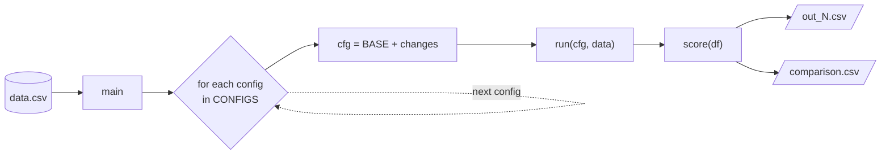
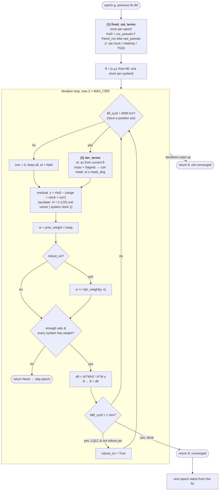
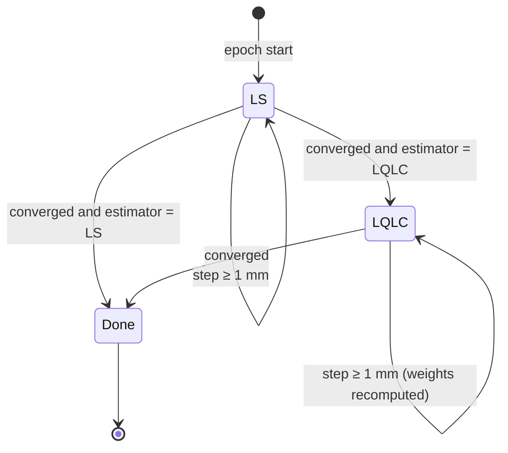
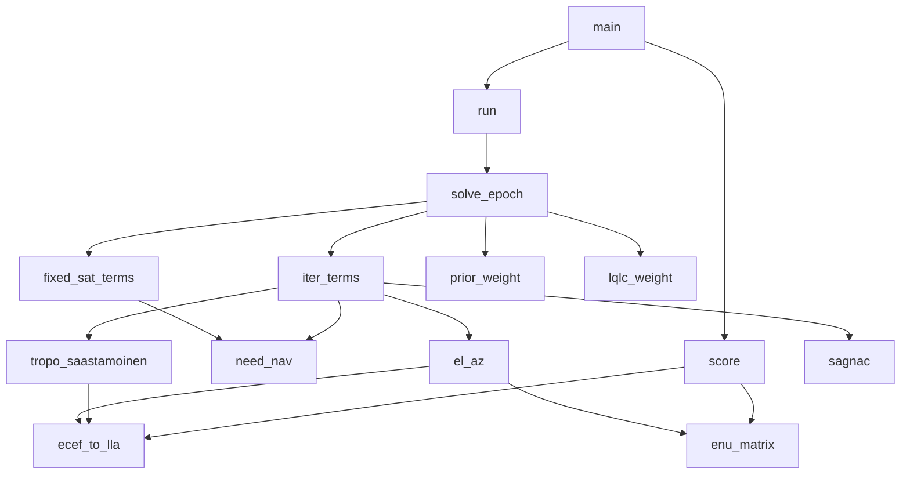
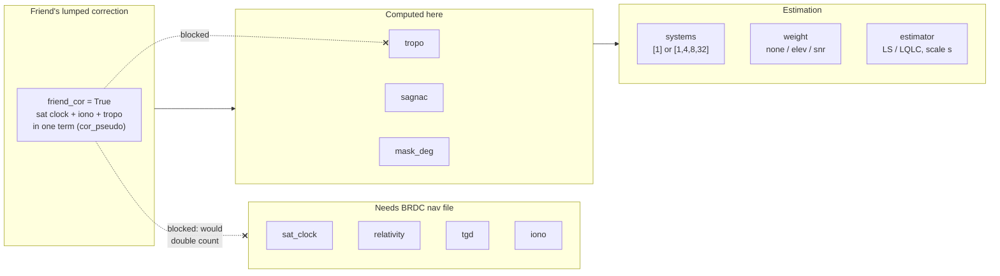
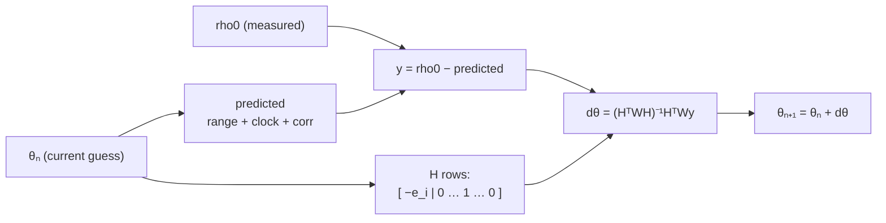
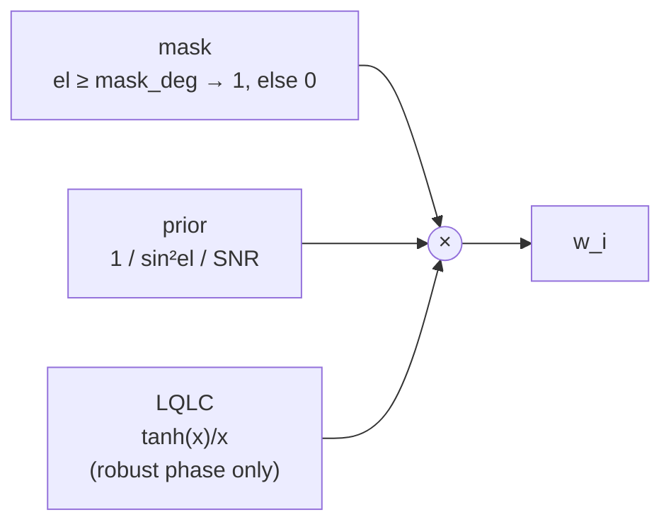
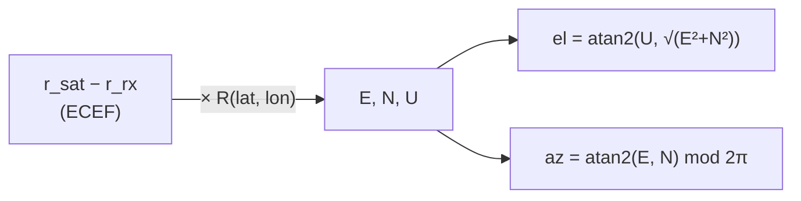
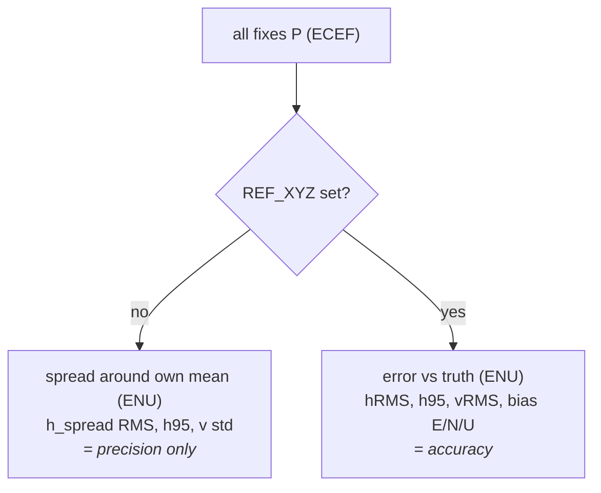

# SPP with Correction Switches: LS / WLS / LQLC

`spp_switches.py` computes the receiver position every epoch from GNSS pseudoranges (Single Point Positioning).
It runs the same data through several **configs**. Each config switches corrections, constellations, weighting
and estimator on or off, and the script prints one comparison table.

```bash
.venv/bin/python spp_switches.py data.csv
```

**Input:** a CSV with `epoch, sat_const, sat_x, sat_y, sat_z, sat_snr, raw_pseudo, cor_pseudo`
**Output:** `out_<N>.csv` (one fix per epoch for each config) and `comparison.csv` (one summary row per config)

---

## 1. Big picture



## 2. Per-epoch solver flow



## 3. LS → LQLC switch-over



LS runs first because robust weights only make sense once the residuals are small. From Earth's centre every
residual is about 20,000 km and every satellite would get roughly the same weight.

---

## 4. Functions



| Function | When it runs | What it does |
|---|---|---|
| `ecef_to_lla(p)` | helper | ECEF → geodetic lat/lon/height (WGS-84, 5 iterations) |
| `enu_matrix(lat, lon)` | helper | Rotation from an ECEF difference to local East/North/Up |
| `el_az(sat, rx)` | every iteration | Elevation and azimuth of each satellite from the receiver |
| `tropo_saastamoinen(el, rx)` | every iteration | Tropospheric delay (m), standard atmosphere |
| `sagnac(sat, rx)` | every iteration | Earth-rotation range term (m) |
| `need_nav(name)` | stub | Raises an error: the correction needs the BRDC navigation file |
| `fixed_sat_terms(g, cfg)` | once per epoch | Builds `rho0` and blocks corrections that would be applied twice |
| `iter_terms(sat, θ, cfg, have_pos)` | every iteration | Position-dependent corrections and elevation mask from the current θ |
| `prior_weight(el, snr, cfg)` | every iteration | Weight set before looking at residuals: none / elevation / SNR |
| `lqlc_weight(y, s)` | robust phase | Robust weight from the residuals |
| `solve_epoch(g, θ0, cfg)` | per epoch | Gauss-Newton / IRLS solver |
| `run(cfg, data)` | per config | Loops over epochs and carries each converged fix forward |
| `score(df, ref)` | per config | Spread statistics, or error and bias when `REF_XYZ` is set |

---

## 5. Switches

All settings live in `BASE`. Each entry in `CONFIGS` overrides only the keys it names.



| Switch | Values | Meaning |
|---|---|---|
| `friend_cor` | bool | Your friend's satellite clock + iono + tropo as one lumped term (uses `cor_pseudo`). `False` uses uncorrected `raw_pseudo`. Turn it off before switching on `sat_clock`, `iono`, `tropo`, `tgd` or `relativity` |
| `sat_clock` | bool | + c·dt_sat (needs NAV) |
| `relativity` | bool | + relativistic clock term (needs NAV) |
| `tgd` | bool | − c·TGD group delay (needs NAV) |
| `iono` | bool | Klobuchar ionosphere (needs NAV) |
| `tropo` | bool | Saastamoinen, recomputed every iteration |
| `sagnac` | bool | Earth rotation, recomputed every iteration |
| `systems` | list | `1` GPS, `4` GLONASS, `8` Galileo, `32` BeiDou. One clock unknown per system |
| `mask_deg` | degrees | Satellites below this elevation get weight 0 |
| `weight` | `none` / `elev` / `snr` | Prior weighting model |
| `estimator` | `LS` / `LQLC` | Plain least squares, or LS followed by robust LQLC |
| `s` | metres | LQLC scale. Larger values behave more like LS |

Other settings: `REF_XYZ` (surveyed antenna ECEF, enables true-error scoring), `MAX_ITER`, `TOL`.

---

## 6. Math

### 6.1 Measurement model

For satellite $i$ in constellation $k$:

$$
\rho_i = \lVert \mathbf{r}^{s}_i - \mathbf{r} \rVert + c\,\delta t_k + T_i + I_i + S_i - c\,\delta t^{s}_i + \varepsilon_i
$$

Unknowns: $\boldsymbol\theta = [x,\ y,\ z,\ c\delta t_{GPS},\ c\delta t_{GLO},\ \dots]$. Every constellation keeps its own
time, so each one gets its own receiver clock.

### 6.2 Linearisation



$$
y_i = \rho_{0,i} - \left(\lVert \mathbf{r}^{s}_i - \mathbf{r}_n \rVert + c\delta t_k + T_i + S_i\right),
\qquad
\mathbf{H}_i = \Big[\, -\mathbf{e}_i^\top \;\big|\; 0 \cdots 1_{(k)} \cdots 0 \,\Big],
\qquad
\mathbf{e}_i = \frac{\mathbf{r}^{s}_i - \mathbf{r}_n}{\lVert \mathbf{r}^{s}_i - \mathbf{r}_n \rVert}
$$

### 6.3 Weighted least squares step

$$
\Delta\boldsymbol\theta = (\mathbf{H}^\top \mathbf{W} \mathbf{H})^{-1}\mathbf{H}^\top \mathbf{W}\,\mathbf{y},
\qquad \mathbf{W} = \operatorname{diag}(w_i)
$$

Iterate until $\lVert \Delta\boldsymbol\theta_{xyz} \rVert < 1\ \text{mm}$.

The total weight is the product of three factors:



### 6.4 Prior weights

| Mode | Weight | Assumption |
|---|---|---|
| `none` | $w_i = 1$ | All satellites equally good |
| `elev` | $w_i = \sin^2(el_i)$ | $\sigma_i \propto 1/\sin(el_i)$: low satellites see more atmosphere and multipath |
| `snr` | $w_i = 10^{(C/N_0)_i/10} \,/\, 10^{4.5}$ | Variance $\propto 1/(C/N_0)_{\text{linear}}$, normalised to 45 dB-Hz |

### 6.5 LQLC robust estimator

Instead of $\sum r_i^2$, minimise

$$
J(\boldsymbol\theta) = \sum_i \ln\cosh\!\left(\frac{r_i}{2s}\right)
$$

| Residual size | Behaviour | Effect |
|---|---|---|
| $\lvert r\rvert \ll 2s$ | $\ln\cosh u \approx u^2/2$ | Same as least squares |
| $\lvert r\rvert \gg 2s$ | $\ln\cosh u \approx \lvert u\rvert$ | Like L1: an outlier can't dominate |

IRLS weight from the influence function $\psi(r) = \frac{1}{2s}\tanh\frac{r}{2s}$:

$$
w_i = \frac{\psi(r_i)}{r_i} \;\propto\; \frac{\tanh x_i}{x_i},
\qquad x_i = \frac{\lvert r_i\rvert}{2s}
$$

$w \to 1$ for small residuals and $w \approx 2s/\lvert r\rvert$ for large ones. The constant $1/(4s^2)$ cancels in
the normal equations.

### 6.6 Troposphere (Saastamoinen, RTKLIB form)

$$
\begin{aligned}
P &= 1013.25\,(1 - 2.2557\times10^{-5} h)^{5.2568} \quad \text{hPa}\\
T &= 15 - 0.0065\,h + 273.16 \quad \text{K}\\
e &= 6.108 \times 0.7 \times \exp\!\left(\frac{17.15\,T - 4684}{T - 38.45}\right) \quad \text{(70\% humidity)}\\
\text{ZHD} &= \frac{0.0022768\,P}{1 - 0.00266\cos 2\varphi - 0.00028\,h/1000}\\
\text{ZWD} &= 0.002277\left(\frac{1255}{T} + 0.05\right)e\\
T_i &= \frac{\text{ZHD} + \text{ZWD}}{\sin(\max(el_i,\ 1^\circ))}
\end{aligned}
$$

### 6.7 Sagnac (Earth rotation)

While the signal travels for about 70 ms, the Earth rotates under it:

$$
S_i = \frac{\omega_e}{c}\left(x^{s}_i\,y_r - y^{s}_i\,x_r\right),
\qquad \omega_e = 7.2921151467\times10^{-5}\ \text{rad/s}
$$

### 6.8 Elevation and azimuth



$$
\mathbf{R} =
\begin{bmatrix}
-\sin\lambda & \cos\lambda & 0\\
-\sin\varphi\cos\lambda & -\sin\varphi\sin\lambda & \cos\varphi\\
\cos\varphi\cos\lambda & \cos\varphi\sin\lambda & \sin\varphi
\end{bmatrix}
$$

---

## 7. Scoring



Without `REF_XYZ` the table only measures **precision**: how tightly the fixes cluster. A config can be precise
and still biased, so set `REF_XYZ` to a surveyed antenna position to measure true accuracy.

---

## 8. Adding a config

Add one line to `CONFIGS` containing only the keys that differ from `BASE`:

```python
"7 all GNSS, LQLC + snr": dict(systems=[1, 4, 8, 32], estimator="LQLC", weight="snr"),
```

The first word of the name (`7`) becomes the output file name `out_7.csv`.
