# SPP: LS vs LQLC

`spp_switches.py` computes the receiver position every epoch from GNSS pseudoranges (Single Point Positioning).
It solves every epoch with both **LS** and **LQLC** on the receiver's `cor_pseudo` and compares them. Between runs
you change the satellites, elevation mask or LQLC scale in `BASE`.

```bash
.venv/bin/python spp_switches.py data.csv       # LS + LQLC → next free run<N>/ folder, viewer included
.venv/bin/python spp_switches.py data.csv run1  # re-run run1/ from its own config.json (same settings)
.venv/bin/python build_viewer.py run1           # rebuild the viewer for one run (newest if omitted)
```

**Input:** a CSV with `epoch, tow, sat_const, sat_x, sat_y, sat_z, cor_pseudo`

## Files

| File | What it does | Output |
|---|---|---|
| `spp_switches.py` | **Main solver.** LS vs LQLC per epoch on `cor_pseudo`; settings in `BASE` | `run<N>/` |
| `sweep.py` | Imports `spp_switches` and runs every elevation mask × LQLC `s` combination in parallel | `run<N>/` + `sweep.txt` |
| `feasibility.py` | Imports `spp_switches`, records every satellite's SNR next to its residual, and tests whether SNR predicts bad ranges (MOMENT step 1) | `feas<N>/` |
| `spp_snrgate.py` | Copy of `spp_switches` with a causal SNR gate (veto / down-weight suspects): does the gate beat LQLC alone? (MOMENT step 2) | `run<N>/` |
| `spp_sigma.py` | Copy of `spp_switches` with RTKLIB's elevation/system noise model σᵢ, as a prior weight 1/σᵢ² and/or a per-satellite `s` | `run<N>/` |
| `build_viewer.py` | Map viewer for a run (called automatically) | `run<N>/viewer.html` |
| `build_sweep.py` | Summary page for a sweep: dropdowns, charts, heatmap (called automatically) | `run<N>/sweep.html` |
| `templates/` | The two HTML templates the builders fill in | |
| `MOMENT-GNSS-proposal.md` | Proposal for a MOMENT pre-filter, assessed with `feasibility.py` and `spp_snrgate.py` | |

| Folder | Contents |
|---|---|
| `run1`, `run2` | Old correction-step runs (GPS 10° / all GNSS 15°); only their `s0_*` configs are valid |
| `run3` | LS vs LQLC, all GNSS, 10°, s = 3 |
| `run4` | Sweep: masks 5–20° × s 1–10 m (open `sweep.html`) |
| `feas1` | Feasibility: SNR vs residual (`feasibility.txt`) |
| `run7` | SNR-gate decision test |
| `run9` | RTKLIB noise model / per-satellite `s` test |

---

## Findings: what we tried to enhance LQLC

All tests: `cor_pseudo` (already corrected for clock, iono, tropo, Sagnac), 6693 epochs, Hong Kong urban
canyon. Numbers are **spread around each config's own mean** (precision): horizontal RMS / vertical std, in metres.

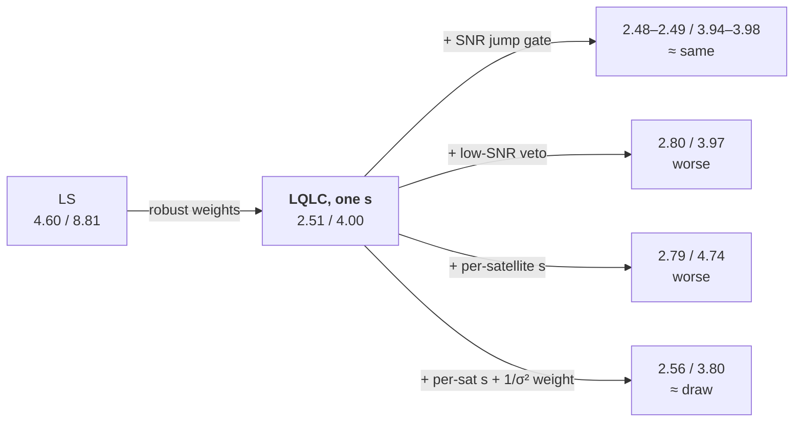

| # | Idea | How | Result | Verdict |
|---|---|---|---|---|
| 1 | **LQLC instead of LS** | Robust `tanh(x)/x` weights after an LS start | H 4.60 → **2.51** (−45%), V 8.81 → **4.00** (−55%) | ✅ **Main gain** |
| 2 | More satellites | GPS only → GPS + GLONASS + Galileo + BeiDou | LQLC H 4.08 → 2.72 at 10° (run1 → run3); LS barely changes | ✅ LQLC needs the redundancy |
| 3 | Tune mask and `s` | Sweep masks 5–20° × `s` 1–10 m (run4) | Best mask 5°, `s` 3–5 m; `s` moves H by only ~0.5 m. A high mask helps LS but hurts LQLC | ✅ Constant `s` is fine |
| 4 | SNR as a warning sign | Feasibility (feas1): SNR vs residual | Below 30°, an SNR jump > 2 dB marks 22–45% bad ranges (vs 4% average) | ✅ The signal is real |
| 5 | SNR jump gate | Veto / down-weight such satellites before solving (run7) | LS: 95% error −43%. **LQLC: only −1 to −3%** | ⚠️ LQLC already does its job |
| 6 | Low-SNR veto | Drop satellites with SNR ≤ 30 dB-Hz below 30° (run7) | LQLC H **+12% worse** | ❌ Removes useful satellites |
| 7 | RTKLIB noise model | σᵢ from elevation + system as weight 1/σᵢ² (run9) | LS: H −38%. LQLC + weight + per-sat `s`: H +2%, V −5% | ⚠️ Helps LS, a draw for LQLC |
| 8 | Per-satellite `s` | `s_i = s·σᵢ/σ_ref` (run9) | LQLC H **+11%**, V **+19% worse** | ❌ Lets bounced signals back in |
| 9 | MOMENT pre-filter | Not built: ideas 4–5 show its room on top of LQLC is ~1–3% | – | ⏸️ Not worth it for now |

**Conclusion.** LQLC with a single constant `s` already captures what the extra ideas try to add. SNR
filtering and elevation noise models are genuinely useful for **LS**, but LQLC alone does better than LS with
either of them, and adding them to LQLC changes little or makes it worse.

**Why the elevation model fails here:** it assumes low satellites are noisier in a random, harmless way, which
is true in open sky. In the urban canyon much of their extra error is bounced (multipath / NLOS) signals,
i.e. outliers. LQLC with one `s` down-weights them; a larger per-satellite `s` relabels them as normal.

**Caveats**
- **Precision, not accuracy:** no surveyed antenna position yet (`REF_XYZ`). `mean_h` differs by a few
  metres between configs, so a tight config could still be biased.
- **One dataset:** one receiver, one site, one session. In open sky the noise model may help more.
- **`s` not re-tuned for per-satellite `s`:** only `s` = 3 and 5 tried there.
- "Doesn't help" means **"doesn't help on top of LQLC"**: ideas 5 and 7 are real improvements for LS.

**Next steps:** a surveyed reference position (accuracy instead of precision), a second dataset (open sky
or UrbanNav), and an oracle veto test (the best any pre-filter could do) to close the MOMENT question.

---

## 1. What a run compares

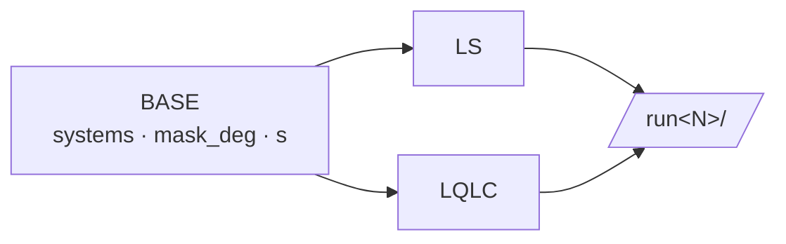

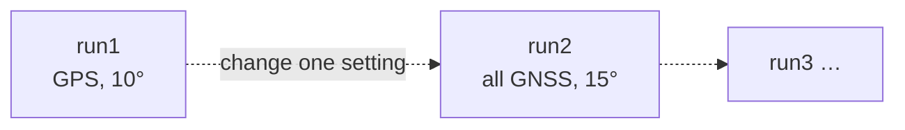

Change **one** setting per run, so any difference between runs can be traced to it. Each run's `config.json`
records what was used.

> **`cor_pseudo` is already corrected.** The supervisor confirmed that the receiver applied ionosphere,
> troposphere and Sagnac (and the satellite clock) to `cor_pseudo`. So the `sagnac`, `tropo` and `iono`
> switches stay **off**: switching them on applies a correction twice. Testing showed exactly that: Sagnac moved
> the fix about 32 m east–west off the antenna site, and tropo + iono lowered the height by about 19 m.
> The correction functions are kept for a possible future `raw_pseudo` path.

---

## 2. Big picture

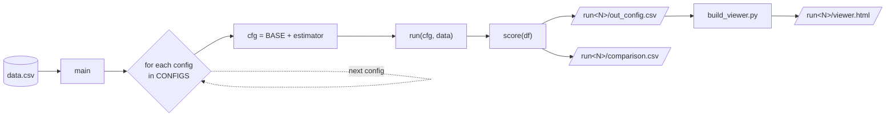

## 3. Per-epoch solver flow


All corrections are recomputed **every iteration**, because they depend on the current position estimate.

## 4. LS → LQLC switch-over

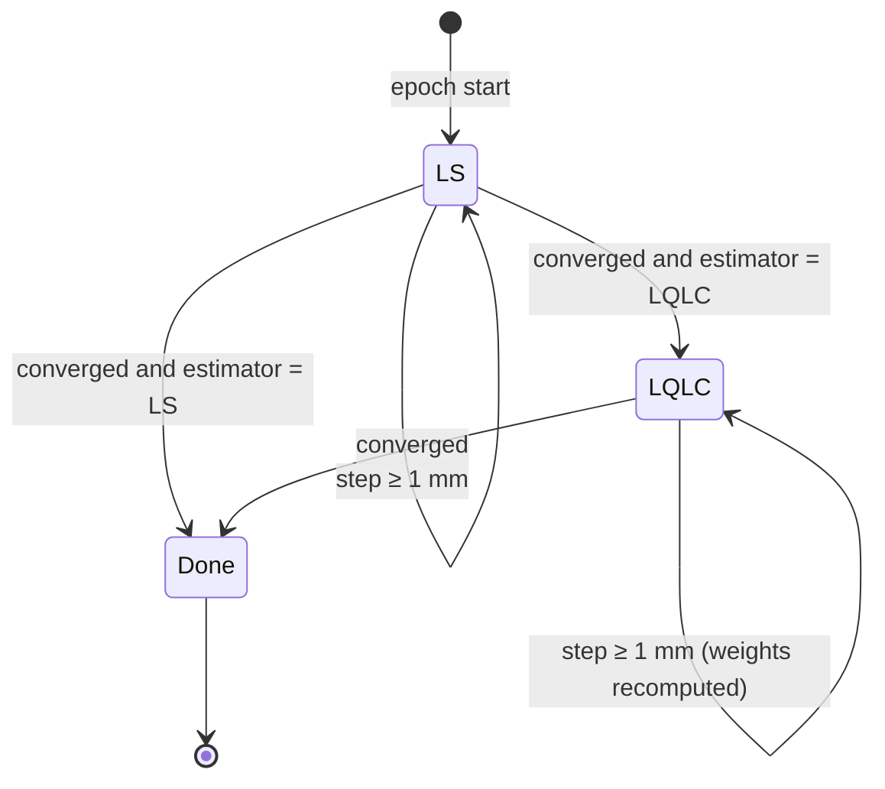

LS runs first because robust weights only make sense once the residuals are small. From Earth's centre every
residual is about 20,000 km and every satellite would get roughly the same weight.

---

## 5. Functions

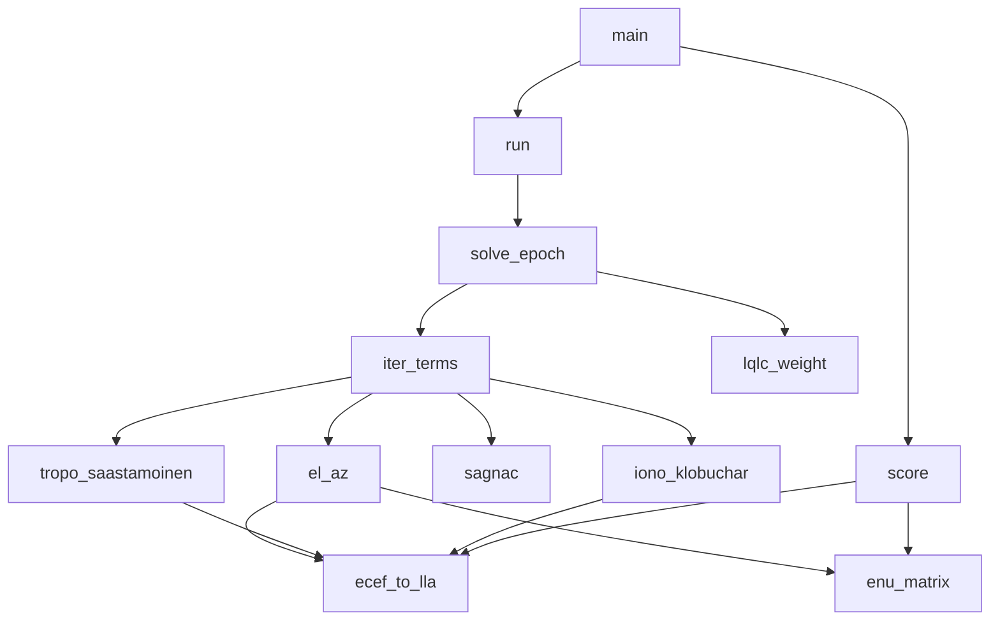

| Function | When it runs | What it does |
|---|---|---|
| `ecef_to_lla(p)` | helper | ECEF → geodetic lat/lon/height (WGS-84, 5 iterations) |
| `enu_matrix(lat, lon)` | helper | Rotation from an ECEF difference to local East/North/Up |
| `el_az(sat, rx)` | every iteration | Elevation and azimuth of each satellite from the receiver |
| `sagnac(sat, rx)` | every iteration | Earth-rotation range term (m) |
| `tropo_saastamoinen(el, rx)` | every iteration | Tropospheric delay (m). Returns 0 outside 0–10 km height (still converging) |
| `iono_klobuchar(el, az, rx, tow)` | every iteration | Ionospheric L1 delay (m), default coefficients |
| `iter_terms(...)` | every iteration | Adds up the switched-on corrections and applies the elevation mask |
| `lqlc_weight(y, s)` | robust phase | Robust weight from the residuals |
| `solve_epoch(g, θ0, cfg)` | per epoch | Gauss-Newton / IRLS solver |
| `run(cfg, data)` | per config | Loops over epochs and carries each converged fix forward |
| `score(df, ref)` | per config | Spread statistics, or error and bias when `REF_XYZ` is set |

---

## 6. Settings

`BASE` holds the settings of a run. Each config is `BASE` + an estimator.

| Setting | Values | Meaning |
|---|---|---|
| `systems` | list | `1` GPS, `4` GLONASS, `8` Galileo, `32` BeiDou. One clock unknown per system |
| `mask_deg` | degrees | Satellites below this elevation get weight 0 |
| `s` | metres | LQLC scale. Larger values behave more like LS |
| `estimator` | `LS` / `LQLC` | Set by `CONFIGS`: every run solves both |
| `sagnac` | bool | **Keep `False`**: already in `cor_pseudo` (only for raw pseudoranges) |
| `tropo` | bool | **Keep `False`**: already in `cor_pseudo` (only for raw pseudoranges) |
| `iono` | bool | **Keep `False`**: already in `cor_pseudo` (only for raw pseudoranges) |

Other settings: `REF_XYZ` (surveyed antenna ECEF, enables true-error scoring), `MAX_ITER`, `TOL`.

---

## 7. Math

### 7.1 Measurement model

For satellite $i$ in constellation $k$:

$$
\rho_i = \lVert \mathbf{r}^{s}_i - \mathbf{r} \rVert + c\,\delta t_k + S_i + T_i + I_i + \varepsilon_i
$$

Unknowns: $\boldsymbol\theta = [x,\ y,\ z,\ c\delta t_{GPS},\ \dots]$. Every constellation keeps its own time, so each
one gets its own receiver clock.

### 7.2 Linearisation

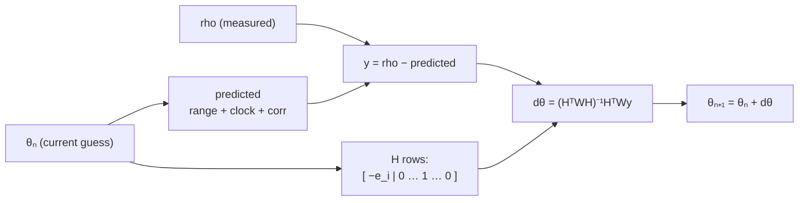

$$
y_i = \rho_i - \left(\lVert \mathbf{r}^{s}_i - \mathbf{r}_n \rVert + c\delta t_k + S_i + T_i + I_i\right),
\qquad
\mathbf{H}_i = \Big[\, -\mathbf{e}_i^\top \;\big|\; 0 \cdots 1_{(k)} \cdots 0 \,\Big],
\qquad
\mathbf{e}_i = \frac{\mathbf{r}^{s}_i - \mathbf{r}_n}{\lVert \mathbf{r}^{s}_i - \mathbf{r}_n \rVert}
$$

### 7.3 Weighted least squares step

$$
\Delta\boldsymbol\theta = (\mathbf{H}^\top \mathbf{W} \mathbf{H})^{-1}\mathbf{H}^\top \mathbf{W}\,\mathbf{y},
\qquad \mathbf{W} = \operatorname{diag}(w_i)
$$

Iterate until $\lVert \Delta\boldsymbol\theta_{xyz} \rVert < 1\ \text{mm}$.

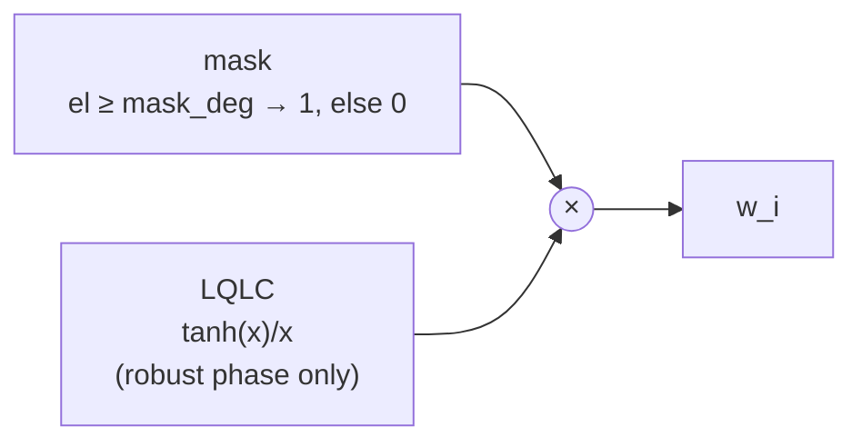

### 7.4 LQLC robust estimator

Instead of $\sum r_i^2$, minimise

$$
J(\boldsymbol\theta) = \sum_i \ln\cosh\!\left(\frac{r_i}{2s}\right)
$$

| Residual size | Behaviour | Effect |
|---|---|---|
| $\lvert r\rvert \ll 2s$ | $\ln\cosh u \approx u^2/2$ | Same as least squares |
| $\lvert r\rvert \gg 2s$ | $\ln\cosh u \approx \lvert u\rvert$ | Like L1: an outlier can't dominate |

IRLS weight from the influence function $\psi(r) = \frac{1}{2s}\tanh\frac{r}{2s}$:

$$
w_i = \frac{\psi(r_i)}{r_i} \;\propto\; \frac{\tanh x_i}{x_i},
\qquad x_i = \frac{\lvert r_i\rvert}{2s}
$$

$w \to 1$ for small residuals and $w \approx 2s/\lvert r\rvert$ for large ones. The constant $1/(4s^2)$ cancels in
the normal equations.

### 7.5 Sagnac (switch, off: already in `cor_pseudo`)

While the signal travels for about 70 ms, the Earth rotates under it:

$$
S_i = \frac{\omega_e}{c}\left(x^{s}_i\,y_r - y^{s}_i\,x_r\right),
\qquad \omega_e = 7.2921151467\times10^{-5}\ \text{rad/s}
$$

### 7.6 Troposphere: Saastamoinen (switch, off: already in `cor_pseudo`)

$$
\begin{aligned}
P &= 1013.25\,(1 - 2.2557\times10^{-5} h)^{5.2568} \quad \text{hPa}\\
T &= 15 - 0.0065\,h + 273.16 \quad \text{K}\\
e &= 6.108 \times 0.7 \times \exp\!\left(\frac{17.15\,T - 4684}{T - 38.45}\right) \quad \text{(70\% humidity)}\\
\text{ZHD} &= \frac{0.0022768\,P}{1 - 0.00266\cos 2\varphi - 0.00028\,h/1000}\\
\text{ZWD} &= 0.002277\left(\frac{1255}{T} + 0.05\right)e\\
T_i &= \frac{\text{ZHD} + \text{ZWD}}{\sin(\max(el_i,\ 1^\circ))}
\end{aligned}
$$

### 7.7 Ionosphere: Klobuchar (switch, off: already in `cor_pseudo`)

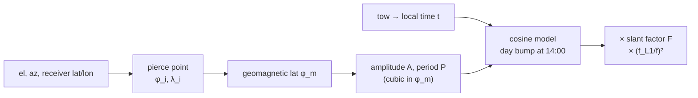

All angles are in semicircles. $E$ is elevation and $A_z$ is azimuth:

$$
\begin{aligned}
\psi &= \frac{0.0137}{E + 0.11} - 0.022 \\
\varphi_i &= \varphi_u + \psi\cos A_z \quad (\text{clamped to } \pm 0.416) \\
\lambda_i &= \lambda_u + \frac{\psi \sin A_z}{\cos \varphi_i} \\
\varphi_m &= \varphi_i + 0.064\cos(\lambda_i - 1.617) \\
t &= 43200\,\lambda_i + t_{GPS} \pmod{86400} \\
A &= \textstyle\max\!\left(0,\ \sum_{n=0}^{3}\alpha_n\varphi_m^n\right),\qquad
P = \max\!\left(72000,\ \sum_{n=0}^{3}\beta_n\varphi_m^n\right) \\
x &= \frac{2\pi(t - 50400)}{P},\qquad F = 1 + 16(0.53 - E)^3 \\
I_i &= c\,F \cdot
\begin{cases}
5\times10^{-9} + A\left(1 - \frac{x^2}{2} + \frac{x^4}{24}\right) & |x| < 1.57\\
5\times10^{-9} & \text{otherwise}
\end{cases}
\end{aligned}
$$

For non-GPS systems the L1 delay is scaled by $(f_{L1}/f)^2$, with nominal frequencies for GLONASS G1, Galileo E1
and BeiDou B1I.

### 7.8 Elevation and azimuth

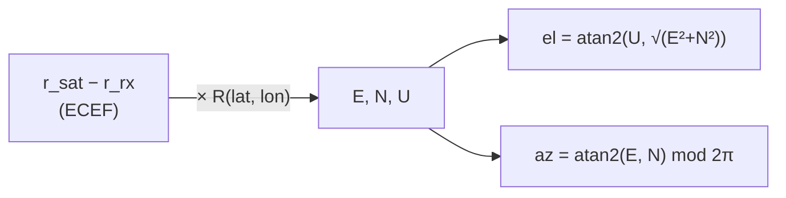

$$
\mathbf{R} =
\begin{bmatrix}
-\sin\lambda & \cos\lambda & 0\\
-\sin\varphi\cos\lambda & -\sin\varphi\sin\lambda & \cos\varphi\\
\cos\varphi\cos\lambda & \cos\varphi\sin\lambda & \sin\varphi
\end{bmatrix}
$$

---

## 8. Scoring

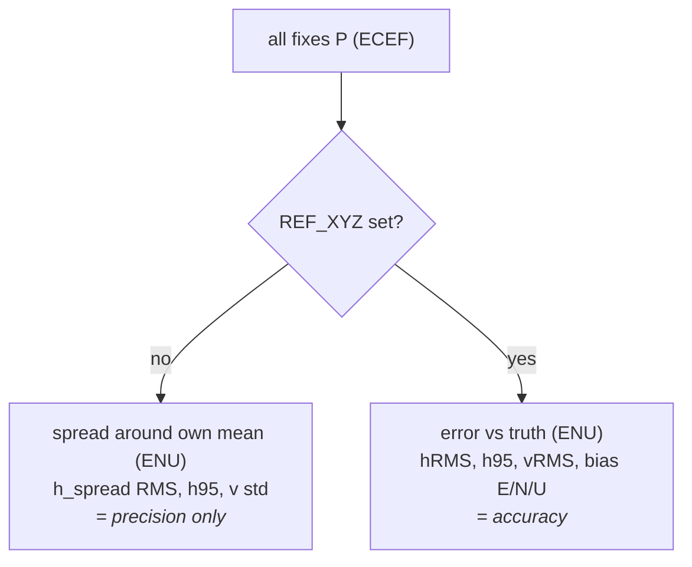

Every config also records its **post-fit residuals**: for each epoch, `res_rms` and `res_max` of
$y_i = \rho_i - \hat\rho_i$ over the satellites used, saved in `out_<config>.csv` and averaged in `comparison.csv`.
They show how well the measurements fit the solution. LQLC usually has a slightly *higher* `res_rms` than LS,
because it lets outliers keep their large residuals instead of bending the position toward them.

Without `REF_XYZ` the table only measures **precision**: how tightly the fixes cluster. A correction mostly shifts
the mean position, which spread can't show. Watch `mean_h`, `lat` and `lon` between runs, and set `REF_XYZ` to a
surveyed antenna position to measure true accuracy.

---

## 9. Runs and viewer

Every run of `spp_switches.py` gets its own folder, so earlier results are never overwritten:

```
run1/
├── config.json        settings of every config in this run
├── comparison.csv     one summary row per config
├── out_LS.csv        one fix per epoch, LS
├── out_LQLC.csv      one fix per epoch, LQLC
└── viewer.html        built automatically at the end of the run
run2/
└── …
```

`build_viewer.py` takes the newest `run<N>/` (or the one you name), reads the config names from its
`comparison.csv`, converts every `out_<config>.csv` to lat/lon/h and fills `templates/viewer_template.html`. The resulting
`viewer.html` shows every config on a map with tracks, per-epoch values (including the residual RMS), statistics
against a chosen reference, and, for reference, each config's spread around its own mean and its average
residuals.

---

## 10. Starting a new run

Change one setting in `BASE`, then run again. The results go into the next `run<N>/`:

```python
BASE = dict(
    ...
    systems=[1, 4, 8, 32],   # e.g. run3: all GNSS
    mask_deg=10.0,           #        back to 10°
    s=3.0,
)
```

To compare more than LS and LQLC in one run, add an entry to `CONFIGS`:

```python
CONFIGS = {
    "LS":      dict(estimator="LS"),
    "LQLC":    dict(estimator="LQLC"),
    "LQLC_s5": dict(estimator="LQLC", s=5.0),   # → out_LQLC_s5.csv
}
```
