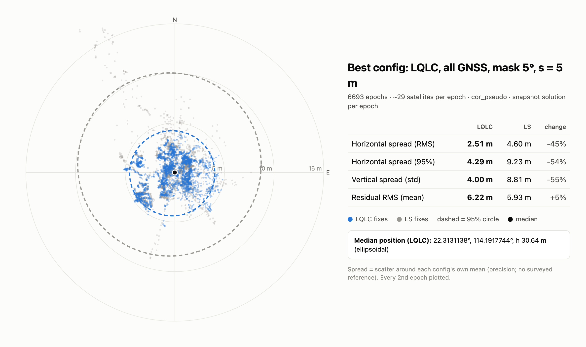
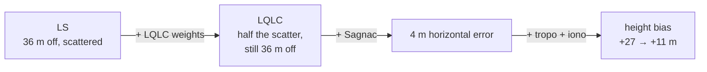
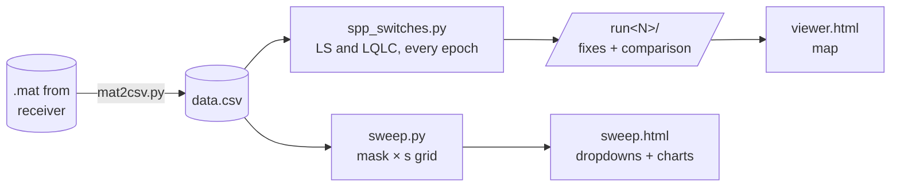
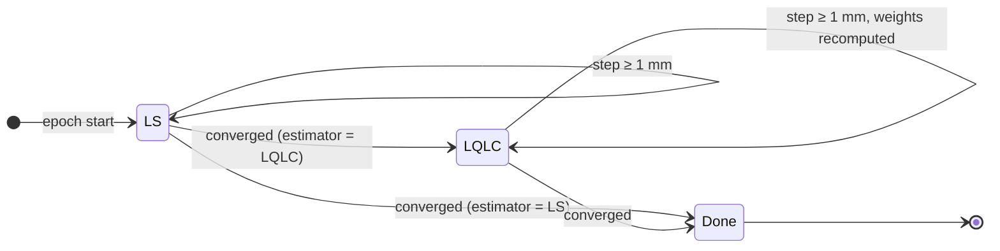
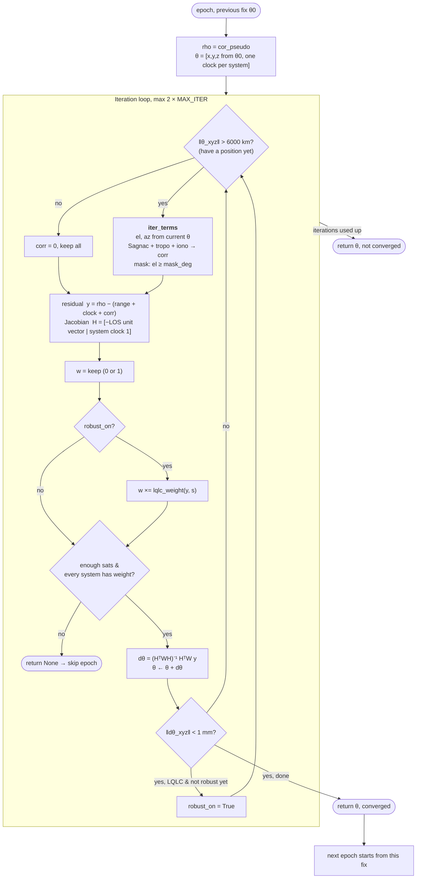
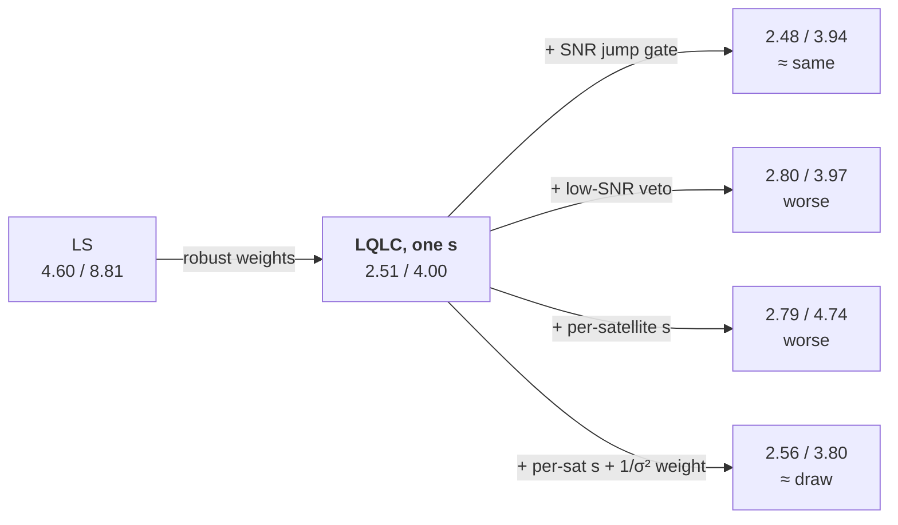

# Robust GNSS Single Point Positioning with LQLC

**Final Year Project.** Every epoch, the receiver position is computed from multi-GNSS pseudoranges in Hong Kong
urban canyons. The standard **least squares (LS)** estimator is compared with **LQLC**, a robust estimator built on
a log-cosh cost. LQLC down-weights reflected (multipath / NLOS) signals instead of letting them pull the position.

> **Bottom line:** LQLC roughly **halves** the position scatter of LS in a dense urban canyon. In a mid-urban
> canyon it cuts the scatter by **about 10×**. Applying Earth-rotation, troposphere and ionosphere corrections
> brings the horizontal error against the true position down from **36 m to about 4 m**.

<p align="center">
  
  <br><sub>Urban dataset, run8: every 2nd epoch of LQLC (blue) and LS (grey) around the median. Dashed circles contain 95% of the fixes.</sub>
</p>

---

## Contents

1. [Key results](#1-key-results)
2. [How it works](#2-how-it-works)
3. [What we tried](#3-what-we-tried)
4. [Quick start](#4-quick-start)
5. [Datasets](#5-datasets)
6. [Project layout](#6-project-layout)
7. [Settings](#7-settings)
8. [Outputs and metrics](#8-outputs-and-metrics)
9. [Correction models](#9-correction-models)
10. [Limitations and next steps](#10-limitations-and-next-steps)

Full derivation from the cost function to Δθ, with the code: **[LQLC_derivation.md](LQLC_derivation.md)**

---

## 1. Key results

### Accuracy against the true position (urban, run12)

The supervisor gave the true antenna position (`REF_LLA`). All runs use mask 5° and s = 5 m.

| Configuration | Horizontal RMS error | Horizontal 95% | Height bias |
|---|---:|---:|---:|
| LS, `cor_pseudo` only | 36.3 m | 38.9 m | +29.9 m |
| LQLC, `cor_pseudo` only | 36.3 m | 39.3 m | +27.3 m |
| LQLC + Sagnac | **4.2 m** | **6.4 m** | +28.6 m |
| LQLC + Sagnac + tropo + iono | 4.3 m | 7.0 m | **+10.6 m** |
| LS + Sagnac + tropo + iono | 5.9 m | 10.3 m | +12.7 m |

`cor_pseudo` only has the satellite clock corrected. The missing Sagnac term alone put every fix about 36 m East.
The three corrections are now **always applied**.

### Precision: scatter around each configuration's own mean

| Dataset | Best settings | LS (H / V) | **LQLC (H / V)** | Improvement |
|---|---|---:|---:|---|
| Urban, `data.csv` (run8) | mask 5°, s = 5 m | 4.60 / 8.81 m | **2.51 / 4.00 m** | −45% / −55% |
| Mid-urban, `data_midurban.csv` (run14) | mask 10°, s = 1 m | 27.05 / 29.51 m | **2.49 / 6.55 m** | −91% / −78% |

H = horizontal RMS, V = vertical standard deviation. The run8 numbers were measured before the corrections were
added; the corrections barely change the scatter.



---

## 2. How it works

### Pipeline



### Per epoch

Unknowns: position $x, y, z$ plus **one receiver clock per satellite system** (GPS, GLONASS, Galileo, BeiDou).

$$
\rho_i = \lVert \mathbf{p}_i - \mathbf{r} \rVert + b_{k(i)} + \underbrace{S_i + T_i + I_i}_{\text{Sagnac, tropo, iono}} + \varepsilon_i
$$

Each Gauss-Newton step solves weighted least squares:

$$
\Delta\theta = (\mathbf{H}^T W \mathbf{H})^{-1}\,\mathbf{H}^T W\,\mathbf{y}
$$

| Estimator | Cost per satellite | Weight $W_{ii}$ |
|---|---|---|
| LS | $\tfrac12 e^2$ | $m_i$ |
| **LQLC** | $4s^2 \ln\cosh\!\big(e/2s\big)$ | $m_i \cdot \dfrac{\tanh x_i}{x_i}$, with $x_i = \dfrac{\lvert e_i\rvert}{2s}$ |

$m_i$ is the elevation mask (1 or 0), and $e_i$ is the satellite's residual.
LQLC behaves like LS for small errors ($\lvert e\rvert \ll 2s$) and grows only linearly for large ones. So a
satellite with a 100 m error keeps about 10% of its weight (with s = 5) instead of dominating the solution.



LS runs first, because the robust weights only make sense once the residuals are small. Elevation, the mask and
the corrections are recomputed at **every iteration** from the current position. Each epoch is solved on its own
(snapshot); the previous fix is only the starting guess.

<details>
<summary><b>Full solver flowchart</b></summary>



| Function | Runs | What it does |
|---|---|---|
| `ecef_to_lla`, `lla_to_ecef` | helper | ECEF ↔ geodetic (WGS-84) |
| `enu_matrix`, `el_az` | every iteration | Local East/North/Up, satellite elevation and azimuth |
| `sagnac`, `tropo_saastamoinen`, `iono_klobuchar` | every iteration | The three corrections (m) |
| `iter_terms` | every iteration | Adds up the corrections and applies the mask |
| `lqlc_weight` | LQLC phase | $\tanh(x)/x$ |
| `solve_epoch` | per epoch | Gauss-Newton / IRLS solver |
| `run` | per config | Loops over epochs, carrying each converged fix forward |
| `score` | per config | Spread, residuals and, with `REF_LLA`, error and bias |

</details>

---

## 3. What we tried

Urban dataset, measured before the corrections were added (precision only). Numbers are H / V scatter in metres.



| # | Idea | Weight $W_{ii}$ / method | Result | Verdict |
|---|---|---|---|---|
| 1 | **LQLC instead of LS** | $m_i \tanh(x_i)/x_i$ after an LS start | H −45%, V −55% | ✅ **Main gain** |
| 2 | More satellites | GPS only → GPS + GLO + GAL + BDS | LQLC H 4.08 → 2.72 m (run1 → run3); LS barely changes | ✅ LQLC needs the redundancy |
| 3 | Tune mask and $s$ | Sweep 5–20° × $s$ 1–10 m (run4, run14) | Best depends on the environment; see [Key results](#1-key-results) | ✅ Tune per site |
| 4 | **Sagnac, tropo, iono** | Added to the model (run12) | Horizontal error 36 → 4 m, height bias +27 → +11 m | ✅ **Always on** |
| 5 | SNR as a warning sign | SNR vs residual (feas1) | Below 30°, an SNR jump > 2 dB marks 22–45% bad ranges (vs 4% average) | ✅ The signal is real |
| 6 | SNR jump gate | Suspects: $W_{ii} = 0$ or ×0.1 (run7) | LS: 95% error −43%. LQLC: only −1 to −3% | ⚠️ LQLC already does this |
| 7 | Low-SNR veto | Drop SNR ≤ 30 dB-Hz below 30° (run7) | LQLC H +12% worse | ❌ Removes useful satellites |
| 8 | RTKLIB noise model | $m_i/\sigma_i^2$ (run9) | LS: H −38%; still behind LQLC | ⚠️ Helps LS only |
| 9 | Per-satellite $s$ | $x_i = \lvert e_i\rvert / 2s\sigma_i$ (run9) | H +11%, V +19% worse | ❌ Lets reflected signals back in |
| 10 | Both of 8 + 9 | $(m_i/\sigma_i^2)\tanh(x_i)/x_i$ (run9) | H +2%, V −5% | ≈ Draw, not worth it |
| 11 | MOMENT pre-filter | Not built: idea 6 shows only ~1–3% room on top of LQLC | – | ⏸️ Not worth it now |

$\sigma_i = F_{sys}\sqrt{0.3^2 + 0.3^2/\sin el_i}$ is RTKLIB's default noise model ($F$ = 1.5 for GLONASS, 1 otherwise).

**Conclusion.** One constant $s$ in LQLC already captures what the SNR and elevation ideas try to add. Those ideas
are real improvements for **LS**, but LQLC alone beats LS with any of them. The elevation model assumes that low
satellites are noisy in a harmless, random way. In a city, much of their error comes from reflections, which are
outliers, and LQLC handles those better with one $s$.

---

## 4. Quick start

```bash
python3 -m venv .venv && .venv/bin/pip install numpy pandas scipy

.venv/bin/python mat2csv.py "sppStruct_user copy.mat" data_midurban.csv   # .mat → CSV
.venv/bin/python spp_switches.py data.csv          # LS + LQLC → next free run<N>/, with viewer.html
.venv/bin/python spp_switches.py data.csv run12    # re-run run12/ from its own config.json
.venv/bin/python sweep.py data_midurban.csv        # mask × s grid → run<N>/sweep.html
```

Open `run<N>/viewer.html` (map) or `run<N>/sweep.html` (sweep summary) in a browser.

---

## 5. Datasets

The data files are not in git (see `.gitignore`).

| File | Environment | Epochs | Satellites per epoch | GPS week | True position |
|---|---|---:|---:|---:|---|
| `data.csv` | Urban canyon, Hong Kong | 6693 | ~29 | 2215 | ✅ `REF_LLA` |
| `data_midurban.csv` | Mid-urban, Hong Kong | 3861 | ~25 | 2203 | ❌ not yet |

CSV columns: `epoch, week, tow, sat_id, sat_const, sat_x, sat_y, sat_z, sat_el, sat_az, sat_snr, raw_pseudo, cor_pseudo`.
`sat_const` codes: 1 GPS, 4 GLONASS, 8 Galileo, 32 BeiDou.

> When running the mid-urban data, ignore the accuracy columns (`hRMS`, `bias*`): `REF_LLA` is the urban site,
> about 2.8 km away.

---

## 6. Project layout

| File | Role |
|---|---|
| `spp_switches.py` | **Main solver.** LS vs LQLC every epoch; settings in `BASE` and `CONFIGS` |
| `sweep.py` | Imports the solver and runs every mask × $s$ combination in parallel |
| `mat2csv.py` | Converts a `sppStruct` `.mat` file to the CSV layout |
| `spp_noise.py` | Imports the solver and adds RTKLIB's noise model σᵢ: ideas 8, 9 and 8+9. Own `MASK_DEG`, `S`, `REF_LLA` |
| `sweep_noise.py` | Mask × $s$ sweep of idea 8+9 (`LQLC_sig_w_s`) only, with LS per mask as reference |
| `feasibility.py` | Does SNR predict bad pseudoranges? (MOMENT step 1) |
| `spp_snrgate.py` | Older solver copy with a causal SNR gate (MOMENT step 2) |
| `build_viewer.py`, `build_sweep.py` | Build `viewer.html` / `sweep.html` from a run (called automatically) |
| `templates/` | HTML templates for the two pages |
| `LQLC_derivation.md` | Step-by-step math with the matching code |
| `MOMENT-GNSS-proposal.md` | Proposal for a MOMENT anomaly pre-filter, assessed by ideas 5–6 |
| `figures/` | Figures for reports |

<details>
<summary><b>Run folders</b></summary>

| Folder | Data | Contents | Corrections |
|---|---|---|---|
| `run1`, `run2` | urban | Old correction-step runs (GPS 10° / all GNSS 15°) | – |
| `run3` | urban | LS vs LQLC, all GNSS, 10°, s = 3 | off |
| `run4` | urban | Sweep: masks 5–20° × s 1–10 m | off |
| `feas1` | urban | SNR vs residual | off |
| `run7` | urban | SNR-gate test | off |
| `run8`, `run10` | urban | LS vs LQLC, mask 5°, s = 5 (the figure) | off |
| `run9` | urban | RTKLIB noise model / per-satellite $s$ | off |
| `run11` | urban | Sagnac test | step by step |
| `run12` | urban | **Corrections step by step, scored against the true position** | step by step |
| `run13` | mid-urban | Corrections step by step, mask 5°, s = 5 | step by step |
| `run14` | mid-urban | **Sweep: masks 5–20° × s 1–10 m** | on |
| `run15` | mid-urban | Corrections step by step, mask 10°, s = 1 | step by step |

Each folder has `config.json` (exact settings), `comparison.csv` (one row per config), `out_<config>.csv`
(one fix per epoch) and `viewer.html`.

</details>

---

## 7. Settings

All settings are at the top of `spp_switches.py`:

```python
BASE = dict(
    systems=[1, 4, 8, 32],   # 1 GPS, 4 GLONASS, 8 Galileo, 32 BeiDou: one clock unknown each
    mask_deg=10.0,           # satellites below this elevation get weight 0
    estimator="LS",          # 'LS' | 'LQLC' (set per config)
    s=1.0,                   # LQLC scale (m): larger behaves more like LS
)
CONFIGS = {                  # each config = BASE + these changes; all are solved in one run
    "LS":   dict(estimator="LS"),
    "LQLC": dict(estimator="LQLC"),
}
REF_LLA = (22.313095, 114.19142326, 3.0)   # true position (lat, lon, h); None = precision only
```

Sagnac, tropo and iono have no switch: they are always applied. Change one setting per run, so any difference can
be traced to it.

---

## 8. Outputs and metrics

| Metric | Meaning | Needs true position? |
|---|---|---|
| `h_spread`, `h95_spread` | Horizontal RMS / 95th percentile of the fixes around **their own mean** (precision) | no |
| `v_spread` | Vertical standard deviation (precision) | no |
| `mean_h` | Mean ellipsoidal height | no |
| `res_rms`, `res_max` | Post-fit residuals of the satellites used: how well the measurements fit | no |
| `hRMS`, `h95`, `vRMS` | Error against `REF_LLA` (accuracy) | yes |
| `biasE`, `biasN`, `biasU` | Mean offset from the true position | yes |

**Precision is not accuracy.** A configuration can be tight and still biased: before the corrections, LQLC had a
2.5 m scatter but sat 36 m East of the truth.

LQLC usually has a slightly *higher* `res_rms` than LS. It leaves outliers with large residuals instead of bending
the position toward them.

---

## 9. Correction models

<details>
<summary><b>Sagnac (Earth rotation)</b></summary>

While the signal travels for about 70 ms, the Earth rotates under it:

$$
S_i = \frac{\omega_e}{c}\left(x^{s}_i\,y_r - y^{s}_i\,x_r\right),
\qquad \omega_e = 7.2921151467\times10^{-5}\ \text{rad/s}
$$

</details>

<details>
<summary><b>Troposphere: Saastamoinen, standard atmosphere</b></summary>

$$
\begin{aligned}
P &= 1013.25\,(1 - 2.2557\times10^{-5} h)^{5.2568} \quad \text{hPa}\\
T &= 15 - 0.0065\,h + 273.16 \quad \text{K}\\
e &= 6.108 \times 0.7 \times \exp\!\left(\frac{17.15\,T - 4684}{T - 38.45}\right) \quad \text{(70\% humidity)}\\
\text{ZHD} &= \frac{0.0022768\,P}{1 - 0.00266\cos 2\varphi - 0.00028\,h/1000}\\
\text{ZWD} &= 0.002277\left(\frac{1255}{T} + 0.05\right)e\\
T_i &= \frac{\text{ZHD} + \text{ZWD}}{\sin(\max(el_i,\ 1^\circ))}
\end{aligned}
$$

It returns 0 while the height is outside −100 m to 10 km, i.e. while still converging from Earth's centre.

</details>

<details>
<summary><b>Ionosphere: Klobuchar, RTKLIB default coefficients</b></summary>

All angles are in semicircles. $E$ is elevation and $A_z$ is azimuth:

$$
\begin{aligned}
\psi &= \frac{0.0137}{E + 0.11} - 0.022 \\
\varphi_i &= \varphi_u + \psi\cos A_z \quad (\text{clamped to } \pm 0.416) \\
\lambda_i &= \lambda_u + \frac{\psi \sin A_z}{\cos \varphi_i} \\
\varphi_m &= \varphi_i + 0.064\cos(\lambda_i - 1.617) \\
t &= 43200\,\lambda_i + t_{GPS} \pmod{86400} \\
A &= \textstyle\max\!\left(0,\ \sum_{n=0}^{3}\alpha_n\varphi_m^n\right),\qquad
P = \max\!\left(72000,\ \sum_{n=0}^{3}\beta_n\varphi_m^n\right) \\
x &= \frac{2\pi(t - 50400)}{P},\qquad F = 1 + 16(0.53 - E)^3 \\
I_i &= c\,F \cdot
\begin{cases}
5\times10^{-9} + A\left(1 - \frac{x^2}{2} + \frac{x^4}{24}\right) & |x| < 1.57\\
5\times10^{-9} & \text{otherwise}
\end{cases}
\end{aligned}
$$

For non-GPS systems the L1 delay is scaled by $(f_{L1}/f)^2$ (GLONASS G1, Galileo E1, BeiDou B1I).
Default coefficients are used because no navigation (BRDC) file is available. Real ones could reduce the
remaining height bias.

</details>

<details>
<summary><b>Elevation and azimuth</b></summary>

$$
\begin{bmatrix} E \\ N \\ U \end{bmatrix} =
\begin{bmatrix}
-\sin\lambda & \cos\lambda & 0\\
-\sin\varphi\cos\lambda & -\sin\varphi\sin\lambda & \cos\varphi\\
\cos\varphi\cos\lambda & \cos\varphi\sin\lambda & \sin\varphi
\end{bmatrix}
(\mathbf{p}_i - \mathbf{r}),
\qquad
el = \operatorname{atan2}\!\big(U, \sqrt{E^2+N^2}\big),\quad az = \operatorname{atan2}(E, N)
$$

</details>

---

## 10. Limitations and next steps

| Limitation | Next step |
|---|---|
| Height bias of +11 m remains | Get the BRDC navigation file for real Klobuchar coefficients; confirm what the reference height (3 m) refers to |
| Mid-urban has no true position | Ask for its surveyed coordinate, then score accuracy as in run12 |
| On mid-urban, the best $s$ is at the edge of the grid (1 m) | Extend the sweep to $s$ < 1 |
| Snapshot solution, no link between epochs | A filter across epochs (e.g. Kalman) could smooth the track |
| Two sites, one receiver | An open-sky dataset would test whether a larger $s$ is better there |
