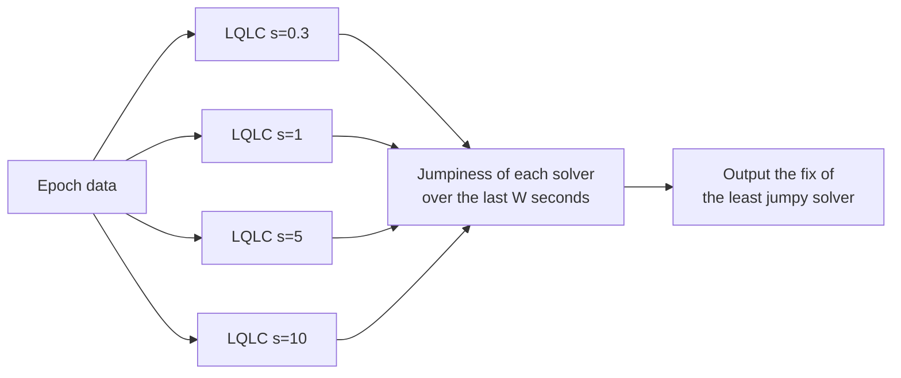

# Research topic: choosing the LQLC scale *s* in the field, without a true position

**Date:** 2026-11-11
**One-line question:** *Can a receiver pick the LQLC scale s by itself, live, with no ground truth, and still do as well as the best hand-tuned s for that site?*

**Proposed title:** *Truth-free online scale selection for the LQLC estimator using temporal consistency*

---

## 1. The gap (why nobody has this yet)

LQLC is very new. It comes from a PolyU group (Li, Yan, Song, Hsu) in two preprints from March 2026 [1][2].
In both papers the scale s is fixed **before** positioning, from data that needs a true position:

| Paper | How s is obtained | Needs ground truth? |
|---|---|---|
| LQLC paper [1] | Fit a logistic curve to all pseudorange errors of a site: 9.5 m (light), 21.3 m (medium), 36.3 m (deep urban) | **Yes** (SPAN-CPT reference) |
| Logistic-aided Huber paper [2] | Same fit, but per 3° elevation bin, then a lookup table | **Yes** |

What is missing:

| Missing piece | Evidence |
|---|---|
| **A way to set s at a new site, where no true position exists** | Neither paper gives one. [2] itself notes that earlier work gives no guideline for choosing the scale |
| **A real-data study of how sensitive LQLC is to s** | [1] only tests this with simulated errors on one epoch's geometry, and concludes that a too-small s hurts much more than a too-large one |
| **A selection signal that is not the residuals** | Other adaptive methods (Gaussian-mixture models [3][4], Barron loss [5], self-tuning Huber, surveyed in [6]) all learn from residuals. [6] notes this is hard without ground-truth errors |

The future work listed in [1] and [2] is integrity (RAIM), DGNSS/RTK, sensor fusion and C/N0-based weighting.
**Online scale selection is not on their list.**

---

## 2. What your own results already show

These come from runs already in this repo (mask 10°, all corrections on, GPS+GLO+GAL+BDS).

| Finding | Numbers | Why it matters |
|---|---|---|
| **The best s differs by site** | Urban: s = 5 (hRMS 4.25 m). Mid-urban: s = 0.3–1 (spread 2.3–2.5 m) | One fixed s cannot be best everywhere |
| **Real data disagrees with the simulation in [1]** | Mid-urban: s = 5 instead of 1 costs **+88%** spread. A too-large s is not safe there | The sensitivity question is open on real data |
| **Residual-based selection fails** | MAD from LS residuals: s moves the wrong way (run21–22). MAD every iteration: no gain over fixed s = 1 (run23–26). Minimum predicted variance: always picks the smallest s | The residuals of one epoch do not contain enough information to choose s |

The third row is the key insight for this topic:
after the fit, the residuals always look consistent with whatever s was used, so they cannot judge s.
**The information has to come from outside the single epoch. The simplest outside source is time.**

---

## 3. The idea in plain words

A good s gives fixes that move smoothly from one second to the next.
A bad s gives fixes that jump, either because bad satellites leak in (s too large) or because the solver becomes unstable (s too small).

So:

1. **Run a small bank of LQLC solvers side by side**, each with a different s (for example 0.3, 0.5, 1, 2, 3, 5, 10 m).
2. **For each solver, measure how jumpy its own recent fixes are**: the RMS step between consecutive fixes over the last W seconds.
3. **At each epoch, output the fix from the solver that is currently the least jumpy.**

Jumpiness of solver k at epoch t, with fixes p:

$$J_k(t) = \sqrt{\frac{1}{W}\sum_{j=t-W+1}^{t} \lVert p_k(j) - p_k(j-1) \rVert^2}, \qquad k^*(t) = \arg\min_k J_k(t)$$

- It needs **no true position** and no extra sensor.
- It costs about 7× the computing time of one LQLC solve, which is still cheap.
- For a **moving** receiver, the expected step is not zero. It must be subtracted first, using Doppler velocity (see section 6).

---

## 4. First test (already done, preliminary)

I ran this as a quick throwaway script on both datasets. It is **not** in a run folder yet.
Settings: mask 10°, bank s = 0.3, 0.5, 1, 2, 3, 5, 10 m, a fix that did not converge cannot be picked.

**All four systems (same setup as run25–28):**

| Method | Urban hRMS (m) | vs best | Mid-urban H spread (m) | vs best | Worst case |
|---|---:|---:|---:|---:|---:|
| LS | 5.81 | +37% | 27.05 | +1066% | |
| Fixed s = 0.3 | 4.91 | +16% | **2.32** | 0% | +16% |
| Fixed s = 1 | 4.65 | +9% | 2.49 | +7% | +9% |
| Fixed s = 5 | **4.25** | 0% | 4.68 | +102% | +102% |
| **Selection, W = 120 s** | 4.31 | +1% | 2.57 | +11% | +11% |
| **Selection, W = 300 s** | 4.36 | +3% | 2.50 | +8% | **+8%** |

**Without GLONASS (GPS + GAL + BDS):**

| Method | Urban hRMS (m) | Mid-urban H spread (m) |
|---|---:|---:|
| LS | 3.85 | 26.48 |
| Best fixed s for that site | 3.74 (s = 5) | 2.64 (s = 0.5) |
| **Selection, W = 120 s** | **3.63** | **2.64** |

**What this shows:**
- **The selector follows the site by itself.** It mostly picks large s on urban (s = 10 about 30–50% of the time) and small s on mid-urban (s ≤ 1 about 90% of the time).
- **Without GLONASS it matches or beats the best fixed s at both sites**, with one setting.
- **With all four systems it is about level with fixed s = 1** in the worst case (+8% vs +9%). But fixed s = 1 was chosen with hindsight from both datasets, and the selector was not.
- This is the first truth-free method in this project that does not lose to a fixed s.

**What it does not show yet (be honest about these):**
- Both datasets are **static**. A stillness test is the easy case.
- Mid-urban is judged by spread only, and the selector minimises jumpiness, which is related to spread. That is partly circular. Urban is the fair test, because it is scored against the true position.
- On mid-urban the vertical spread got worse (about 7.3 m vs 6.5 m).
- Only two sites, one receiver.

**Side finding worth checking separately:** dropping GLONASS improves urban LS from 5.81 to 3.85 m hRMS, and LQLC's lead over LS shrinks to about 3%.
Much of LQLC's urban gain may come from suppressing GLONASS errors.
Find out whether GLONASS is truly bad here or whether the GLONASS model has a gap (for example its per-channel frequency).

---

## 5. Research questions

| # | Question | How to answer it |
|---|---|---|
| RQ1 | How sensitive is LQLC to s on **real** data, and does the conclusion of [1] (a too-large s is safe) hold? | Fine sweep of s on both sites (and more sites if available), plotted like the mismatch figure in [1] |
| RQ2 | Why do residual-based rules (MAD, minimum variance) fail? | Show that post-fit residuals shrink with s whatever the truth is (runs 21–26 and `spp_optim_s.py`) |
| RQ3 | Does temporal-consistency selection match the per-site best s without ground truth? | Section 4, done properly, with the same scoring as the other runs |
| RQ4 | Does it still work when the receiver moves? | Needs Doppler or a moving dataset (section 6) |

RQ1 and RQ2 are already almost answered by existing runs. They are useful results even if RQ3 ends up weak.

---

## 6. Work plan

| Step | What | Effort |
|---|---|---|
| 1 | New file `spp_bank.py` (imports `spp_switches`): the bank, the jumpiness measure, the selector, and the usual run folder output | small |
| 2 | Repeat section 4 as proper runs. Add: window sizes, a finer s grid, and a softer rule (weighted average of the best few solvers instead of a hard switch) | small |
| 3 | Fair baselines: fixed s = 1, MAD-adaptive (`spp_adaptive.py`), and the elevation-table idea of [2] via `spp_noise.py` | small |
| 4 | **Get a true position for mid-urban**: ask the supervisor, or post-process against the SatRef station HKQT (about 3.8 km away) | medium |
| 5 | **A moving dataset with Doppler**: ask the supervisor for raw RINEX, or use the public UrbanNav Hong Kong dataset. Then jumpiness = step minus Doppler-predicted step | medium to large |
| 6 | Write up: sensitivity study (RQ1), why residuals fail (RQ2), the selector (RQ3), limits (RQ4) | |

Steps 1–3 need nothing new and can start now.

---

## 7. Risks

| Risk | What to do |
|---|---|
| The selector does not clearly beat fixed s = 1 with all four systems | Report it honestly. The contribution is then "no tuning needed at a new site", plus RQ1 and RQ2 |
| Smooth is not the same as correct: a solver can sit steadily on a biased fix | Check on urban against the true position (so far hRMS agrees with spread). Add mid-urban truth (step 4) |
| A moving receiver breaks the stillness assumption | Step 5. Without it, state clearly that the result is for static receivers |
| The PolyU group may be working on the same thing | **Ask your supervisor first.** They will know what is in progress |

---

## 8. How sure is "no one did it"?

- **What I searched (2026-11-11):** log-cosh / LQLC / logistic error model in GNSS; adaptive scale or tuning of M-estimators for GNSS; Barron adaptive loss in GNSS; self-tuning mixture models; kernel selection by temporal, position or Doppler consistency.
- **What I found:** offline scale fitting [1][2] and residual-based adaptation [3][4][5][6]. I found **no paper** that selects a robust-estimator scale from the temporal consistency of the fixes, and none that does any online scale selection for LQLC.
- **What I cannot promise:** a web search is not a full literature review. It misses paywalled conference papers and work in progress. LQLC is only months old, so follow-ups may appear soon.

---

## 9. Backup topics

| Topic | Why it is open | Why it is second choice |
|---|---|---|
| **LQLC with DGNSS corrections from HK SatRef** | Listed as future work in [1] and [2]. Removes atmosphere errors so only multipath is left | The authors may do it themselves. Needs reference-station processing code |
| **Per-constellation scale (GLONASS vs the rest)** | [1] used GPS + BDS only. Your data shows GLONASS behaves very differently | Smaller contribution. Could be a chapter of the main topic |
| **Integrity (protection level) for LQLC** | Listed as future work in [1] | Hard theory, and the group works on integrity already |

---

## References

1. Li, Yan, Song, Hsu. *Improved GNSS Positioning in Urban Environments Using a Logistic Error Model.* arXiv:2603.16420, March 2026. https://arxiv.org/abs/2603.16420
2. Li, Yan, Hsu. *Logistic-aided Huber M-estimator for robust GNSS positioning.* arXiv:2603.19640, March 2026. https://arxiv.org/abs/2603.19640
3. Pfeifer, Protzel. *Expectation-Maximization for Adaptive Mixture Models in Graph Optimization.* ICRA 2019. https://arxiv.org/abs/1811.04748
4. Pfeifer, Protzel. *Incrementally learned Mixture Models for GNSS Localization.* 2019. https://arxiv.org/abs/1904.13279
5. Ahmadi, Olama, Välisuo, Kuusniemi. *Adaptive Factor Graph-Based Tightly Coupled GNSS/IMU Fusion for Robust Positioning.* arXiv:2511.23017, 2025. https://arxiv.org/abs/2511.23017
6. *Robust Statistics vs. Machine Learning vs. Bayesian Inference: Insights into Handling Faulty GNSS Measurements in Field Robotics.* arXiv:2504.06015, 2025. https://arxiv.org/abs/2504.06015
7. Garcia Crespillo, Andreetti, Grosch. *Design and Evaluation of Robust M-estimators for GNSS Positioning in Urban Environments.* ION ITM 2020. https://elib.dlr.de/134158
